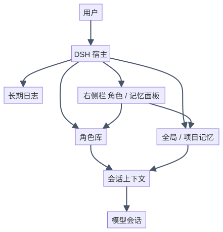
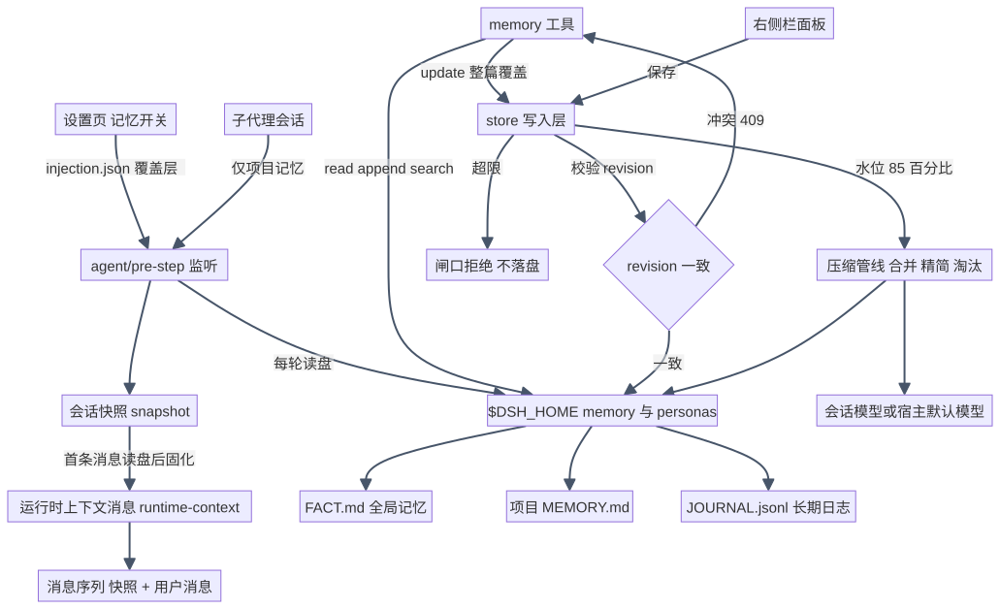

# 角色与记忆（persona-memory）

[](LICENSE)

DSH 的角色库与长期记忆插件：把角色设定、全局/项目两级记忆与可检索的长期日志，在每条会话首条消息前固化成运行时上下文；写入有硬上限与乐观锁，满了走分层压缩。

| 状态 | 信息 |
| --- | --- |
| 最新版本 | [0.14.0](https://github.com/hu568/dsh-plugin-persona-memory/releases) |
| 平台 | DSH 宿主组合（桌面端与 Web 会话）；dsh-go 等 Flutter 客户端只有宿主侧生效，右侧栏面板不渲染 |
| 技术栈 | 纯 ESM JavaScript · 无构建步骤（`lib/*.js` 直接加载）· Cordis 插件 · DSH 宿主 API（`systemPrompt.context`、`tools`、`commands`、`slots`、`webServer`） |
| 核心引擎 | 会话快照 + 运行时上下文注入；两级记忆（FACT.md / MEMORY.md）带行·字节·字符闸口与乐观锁；水位触发的合并 → 精简 → 淘汰压缩管线 |
| 运行依赖 | 本地文件 `$DSH_HOME/personas` 与 `$DSH_HOME/memory`、项目根 `MEMORY.md`；无外部服务（压缩复用会话模型） |

最近一版 0.14.0 把「设置 → 记忆」改成横向页签（注入开关 / 角色卡 / 各附属插件各占一页）；逐版本记录见 [docs/CHANGELOG.md](docs/CHANGELOG.md)。

---

## ✨ 功能总览

给 DSH 里的模型装上「人设 + 长期记忆」：角色设定和两级记忆在每轮对话前自动就位，过时的结论可以标记失效而不删除，写满了自动压缩。

- **角色库**：每个角色一套人格、用户档案与简介，同一时刻一个当前角色；右侧栏面板里就能新建、编辑、排序、切换，`persona action=use` 在新会话生效。
- **两级长期记忆**：全局事实（跨项目）与项目记忆（跟随工作区）分开管理，模型每轮都读得到；文件不存在就不注入，超限直接拒绝写入、不悄悄截断。
- **长期日志**：只追加、不注入上下文的记录，随时按关键词检索；写入前自动脱敏，读回再打一次码。
- **失效与重要性**：过时条目标记失效而不是删除，可一键恢复；条目带 0–100 重要性，压缩时优先淘汰不重要的。
- **上下文注入**：角色与记忆以一条独立消息排在本轮用户消息之前，工具说明再长也压不掉角色，KV 缓存前缀保持稳定。
- **面板与设置**：右侧栏「角色 / 记忆」三个标签管理角色、记忆、日志；设置页顶部是横向页签（注入开关 / 各附属插件各占一页），三个注入开关只管注入，不影响读写。
- **可拆可合**：读侧自动召回、写侧自动沉淀、角色卡导入导出都是独立发布的[附属插件](#-附属插件)，不装也不影响主插件的角色与记忆。
- **隐私**：插件不保存任何 API Key；日志落盘前脱敏（私钥块、`sk-`、`token=`、`Bearer`、手机号、身份证、卡号）。

---

## ⚙️ 下载与安装

在 DSH 插件管理器（创造模式）中安装：

```text
plugin_manager action=install_bundle target="github:hu568/dsh-plugin-persona-memory"
```

桌面端也可走「设置 → 插件」安装；命令行安装、卸载与验证方式见下方[安装 / 运行](#安装--运行)。想要自动召回、自动沉淀或角色卡导入导出，再按[附属插件](#-附属插件)一节各装一个。

> 装包会把包名追加进 profile 的 `dsh.profile.bundles`，引擎经 HMR 重载该层，**装完不用重启**；更新时若安装规格字符串不变会报 `ambiguous-install`，先 `remove` 再 `add`。Flutter 客户端没有 `sidebar.right.pane.tab` / `settings.section` 槽位，面板不渲染，但工具、注入与 HTTP 路由照常。

---

## 🧩 附属插件

主插件自己**不附带**这些功能：它们是各自独立发布、独立安装的插件，共用同一个角色库 / 记忆文件与「设置 → 记忆」页签。不装任何附属插件，主插件的角色与记忆照常工作。

| 附属插件 | 最新版本 | 做什么 | 装后在「设置 → 记忆」 |
| --- | --- | --- | --- |
| [dsh-persona-memory-recall](https://github.com/hu568/dsh-plugin-persona-memory-recall#readme)<br>`@dsh-external/dsh-persona-memory-recall` | 0.6.0 | **读侧自动召回**：每轮拿用户消息去本地 `JOURNAL.jsonl` 里 BM25 检索（可选叠加 bge-m3 语义通道 + RRF 融合），把命中的历史片段排在本轮用户消息之前，不占系统提示词前缀 | 页签「自动召回」（含「高级」「语义」分组） |
| [dsh-persona-memory-consolidate](https://github.com/hu568/dsh-plugin-persona-memory-consolidate#readme)<br>`@dsh-external/dsh-persona-memory-consolidate` | 0.7.1 | **写侧自动沉淀**：回合结束只做本地暂存，攒够 6 轮 / 8000 字符才花一次模型调用提炼结论，过质量闸口后经主插件 `store` 写进 JOURNAL / FACT / 项目 MEMORY；撞限只降级 JOURNAL，绝不压缩已有记忆 | 页签「自动沉淀」（含「高级」分组） |
| [dsh-persona-memory-io](https://github.com/hu568/dsh-plugin-persona-memory-io#readme)<br>`@dsh-external/dsh-persona-memory-io` | 0.2.0 | **角色卡导入导出**：把角色导出成 persona-select 兼容的 JSON / PNG 角色卡（PNG 走 iTXt 块，封面像素零改动），也能把卡片作为**新角色**导回角色库；附 `persona_io` 工具 | 独占一个整页页签「角色卡」 |

安装与主插件同规格，先 `remove` 再 `add`（规格字符串不变时更新会报 `ambiguous-install`）：

```powershell
# 插件管理器（创造模式）：
#   plugin_manager action=install_bundle target="github:hu568/dsh-plugin-persona-memory-recall"
dsh plugin --profile <profile> add github:hu568/dsh-plugin-persona-memory-recall
dsh plugin --profile <profile> add github:hu568/dsh-plugin-persona-memory-consolidate
dsh plugin --profile <profile> add github:hu568/dsh-plugin-persona-memory-io

# 卸载（都不动 personas/ 与 memory/，也不影响主插件）
dsh plugin --profile <profile> remove @dsh-external/dsh-persona-memory-recall
```

三点容易踩的：

- **各装一行**：每个附属插件在宿主组合里都是自己的插件行，装一个只多一行；主插件缺席时 io 与 recall 仍能读写同一个角色库 / 日志，只是没有角色注入与设置页页签。
- **peer 版本要匹配**：附属插件用 peerDependencies 声明它要求的主插件范围（以各插件 `package.json` 为准）。pnpm 报 peer 不满足时先看范围再决定装不装，别硬压。
- **装包不用重启，改源码才要**：理由与主插件相同（DSH 不监听 `node_modules`，ESM 有加载缓存）。

---

## 🧱 架构

<picture>
  <source media="(prefers-color-scheme: dark)" srcset="docs/diagrams/architecture-dark.svg">
  
</picture>

渲染图直接入库（浅色 / 深色两版），源码见 [docs/diagrams/architecture.mmd](docs/diagrams/architecture.mmd)。

---

# 🛠️ 对开发者

## 🚀 快速开始

### 环境要求

- DSH 宿主：peer 为 `cordis >=4.0.0-rc <5`、`@deepseek-ai/dsh-tools`、`@deepseek-ai/dsh-system-prompt`；这三个包运行时不解析，由宿主提供。
- 旧 README 实测范围：DSH `0.1.5-rc.1` ~ `0.2.2-rc.1`（末项为 Android / proot Linux 实测）。
- 运行依赖 `schemastery`（别名安装 `npm:@deepseek-ai/schemastery@3.18.2`，随包安装已 hoist 到 profile）。
- 不需要 Harness 源码，也不需要构建工具链。

### 构建

无构建步骤：`lib/*.js` 就是源码（纯 ESM），宿主直接加载；`npm run check` 只做语法检查。

### 安装 / 运行

```powershell
# 插件管理器（创造模式）：
#   plugin_manager action=install_bundle target="github:hu568/dsh-plugin-persona-memory"
# 命令行（桌面端请用插件管理器或「设置 → 插件」）：
dsh plugin --profile <profile> add github:hu568/dsh-plugin-persona-memory
dsh --profile <profile> --dump-config   # 验证：应出现以本包名为标题的层与 persona-memory 行
# 卸载（不删除 personas/ 与 memory/）
dsh plugin --profile <profile> remove @dsh-external/dsh-persona-memory
```

装包会把包名追加进 profile 的 `dsh.profile.bundles`，引擎经 HMR 重载该层，所以**装完不用重启**；但更新时若安装规格字符串不变会报 `ambiguous-install`，先 `remove` 再 `add`。两条容易被误读的输出：pnpm 报 `cordis` / `@deepseek-ai/dsh-tools` / `@deepseek-ai/dsh-system-prompt` peer 缺失可以忽略（运行时不解析）；Flutter 客户端没有 `sidebar.right.pane.tab` / `settings.section` 槽位，面板不渲染，但工具、注入与 HTTP 路由照常。

### 首次配置

1. 首次运行自动建 `$DSH_HOME/memory/FACT.md` 模板；角色库为空时建 `personas/default/`，并把旧 `$DSH_HOME/memory/{SOUL.md,USER.md}` 内容迁移过去（旧文件保留）。
2. 打开「设置 → 记忆」三个开关决定注入范围；开关写 `$DSH_HOME/memory/injection.json`（只存显式设过的布尔键），删掉文件即回组合默认值。
3. 验证：让模型复述它看到的角色与记忆，或调用 `memory action=read` 看体量、上限与 `revision`；面板入口在右侧栏的入口页「角色 / 记忆」。

> 安全说明：本插件不保存任何 API Key；JOURNAL 写入前脱敏、读回再打码；角色与记忆文件都在 `$DSH_HOME` 或项目根，不进插件仓库。项目 `MEMORY.md` 可能随他人仓库分发，所以有库级信任门。

### 配置项与默认值

| 字段 | 默认 | 说明 |
| --- | --- | --- |
| `personaEnabled` | `true` | 注入 `<soul>` / `<user>`；设置页开关可覆盖 |
| `memoryEnabled` | `true` | 注入 `<memory>`，同时是全局 / 项目两个开关的默认值 |
| `subagentProjectOnly` | `true` | 子代理只注入项目记忆 |
| `maxChars` | `8000` | 单文件注入字符上限 |
| `maxFactLines` / `maxFactBytes` | `100` / `8000` | 全局 FACT.md 的行数 / 字节硬上限 |
| `maxProjectChars` | `8000` | 项目 MEMORY.md 字符硬上限，与 `maxChars` 取小值后同时约束写入与注入 |
| `compactionEnabled` | `true` | 压缩管线总开关；关掉后写路径与 0.7.0 逐字节相同 |
| `compactProvider` / `compactModel` | `''` | 合并用的模型；留空继承会话模型，再退宿主默认模型 |
| `compactKeepBackups` | `5` | `memory/backups/` 里每份文件保留的压缩备份数 |
| `trustProjectFromRepo` | `true` | 库级信任门；`false` = 明确信任、不告示 |
| `panelPath` | `/persona-memory` | 面板 HTTP 前缀（客户端一半写死，改前缀要两半同改） |

### 设置页页签与附属插件扩展点

「设置 → 记忆」顶部是一条横向页签，页签按下面的顺序生成（没有对应内容的不出现）：

| 页签 | 来源 | 内容 |
| --- | --- | --- |
| 注入开关 | 本插件 | 三个注入开关 + 开关覆盖层路径 |
| （附属插件整页） | 客户端子槽 `settings.persona-memory.tab` | 每个注册项一整页，用 `renderSlot(..., { only: id })` 只渲染自己那一份 |
| （声明式设置项分组） | `ctx.personaMemory.settings.register()` 的 `group` | 按「 · 」前的顶层名归并成一页（如 `自动召回` / `自动召回 · 高级` 合成一页），组内仍可折叠 |

- 整页插件注册：`ctx.slots.inject('settings.persona-memory.tab', () => ctx.slots.register({ name: 'settings.persona-memory.tab', id, order, label }, Component))`。
- 旧写法 `settings.persona-memory.item`（往本插件页里挂一行）仍受支持；同一个 id 若也注册了整页，则只画整页，不再重复画那行。
- 未选中的页保持挂载（`hidden`），切回来时草稿、折叠状态、搜索词都还在。

### 数据落点

| 平面 | 位置 |
| --- | --- |
| 角色设定 | `$DSH_HOME/personas/<id>/{persona.yml,SOUL.md,USER.md}` |
| 全局记忆 / 长期日志 | `$DSH_HOME/memory/FACT.md`、`$DSH_HOME/memory/JOURNAL.jsonl` |
| 项目记忆 | `<项目根>/MEMORY.md` |
| 侧车状态 | `memory/index.json`（重要性）、`injection.json`（开关）、`locks.json`（人工锁定）、`snapshots/`、`backups/`、`compaction.jsonl` |

### 压缩命令

- 手动：`/memory-compact`（不带参数压缩当前工作区项目 `MEMORY.md`）、`/memory-compact [fact|memory|all] [dry] [seed]`、`/memory-compact rollback <yyyyMMdd-HHmmss>`。
- `seed` 先回填侧车索引（只写 `memory/index.json`，不删正文），`seed dry` 只列计划；侧车索引缺失时淘汰整体跳过，宁可不压缩也不盲删。
- 面板接口：`GET /api/memory/compaction`、`POST /api/memory/lock`、`POST /api/memory/unlock`。

### 已知边界与坑

- **装完不用重启，改源码才要重启**：HMR 只监听 profile 清单与补丁文件，不监听 `node_modules`，ESM 也有加载缓存。
- **`complete: true` 的预设**（如 `minimal`）替换整个系统提示词，段落注入进不去。
- **开关只管注入**：关掉全局记忆后 `memory action=read/update, scope=global` 仍可用。
- **失效条目不释放预算**：状态注释让条目继续占行数与字节，要腾空间只能靠压缩淘汰。
- **历史超限文件不会被自动改写**：`read` 附警告，其后写入被拒。
- **项目写入不带 revision 会被拒**：先 `read` 再写，或显式 `force: true`（会静默覆盖别处改动）。
- **备份分家不迁移旧文件**：0.9.0 之前留在 `memory/backups/` 根的条目级备份不会搬进 `backups/auto/`。
- **`max-tokens` 截断按失败处理**：被 token 上限切断的合并 / 抽取结果不算数，宁可不写。

---

## 🔧 进阶：改源码与跑测试

### 改源码后为何仍是旧行为

改的是 `lib/*.js`：DSH 不监听已装包的 `node_modules`，且 ESM 有加载缓存，所以已装份不会因源文件变化而更新。装包（`dsh plugin add`）能经 HMR 重载该层，但**改源码必须重启 DSH，或 remove 再 add 重装**；只有 `cordis.patch.yml` 有可能热生效。改已安装副本时用「拷临时文件 → 删原文件 → 移回」，避免硬链接写穿 pnpm store。

### 跑测试

```bash
# 一条命令跑全量：逐个跑 test/*.test.mjs 并汇总（等价入口 npm test）
node test/run-all.mjs

# 单独跑某个用例
node test/scope.test.mjs
```

`test/run-all.mjs` 只用 node 内置模块，Windows / Linux / Android(proot) 通用，不依赖 PowerShell 或 Electron；开跑前会调用 `test/ensure-deps.mjs` 自动补 `schemastery` 与宿主包链接（缺才补，失败只警告）。需要真实宿主包的用例由 `test/_host-paths.mjs` 自动探测路径。

---

## 🧱 总架构图

<picture>
  <source media="(prefers-color-scheme: dark)" srcset="docs/diagrams/architecture-full-dark.svg">
  
</picture>

源码见 [docs/diagrams/architecture-full.mmd](docs/diagrams/architecture-full.mmd)。

---

## 📁 仓库结构

```
dsh-plugin-persona-memory/
├── README.md                  # 本文件
├── docs/CHANGELOG.md          # 历史变更（0.8.6–0.14.0）
├── docs/diagrams/             # 渲染好的架构图（SVG，浅色/深色）+ mermaid 源码 .mmd
├── LICENSE / package.json
├── cordis.patch.yml           # 宿主组合补丁
├── lib/                       # 宿主半源码，纯 ESM、无构建
│   ├── index.js / config.js / paths.js / injection.js   # 入口、配置、路径、开关覆盖层
│   ├── persona-store.js / seed.js / snapshot.js         # 角色库、首次运行、会话快照
│   ├── prompt-render.js / entry-state.js                # 注入渲染、条目生命周期
│   ├── journal-search.js / store.js / locks.js          # 检索、存储与闸口、人工锁定
│   ├── compaction.js / compaction-wiring.js / compact-command.js  # 压缩管线与命令
│   ├── tools.js / settings-registry.js / workspace.js / panel.js  # 工具、设置项、工作区、面板 API
│   ├── client.js              # 客户端半（右侧栏面板与设置页控件）
│   └── types/index.d.ts
├── skills/persona-creator/SKILL.md   # 角色创建技能正本，不注册为技能
└── test/                      # 回归测试（run-all.mjs + *.test.mjs）
```

---

## 📚 文档索引

| 文档 | 内容 |
| --- | --- |
| [docs/CHANGELOG.md](docs/CHANGELOG.md) | 历史变更记录，按版本倒序 |
| [docs/diagrams/](docs/diagrams/) | 架构图的渲染产物（`*-light.svg` / `*-dark.svg`）与 mermaid 源码（`.mmd`） |
| [LICENSE](LICENSE) | MIT 许可证全文 |
| [package.json](package.json) | 版本、peerDependencies、入口与文件清单 |
| [cordis.patch.yml](cordis.patch.yml) | 宿主组合补丁与默认配置 |
| [test/run-all.mjs](test/run-all.mjs) | 跨平台测试入口 |
| [skills/persona-creator/SKILL.md](skills/persona-creator/SKILL.md) | 角色创建技能说明（不随包分发） |

---

## 🗺️ 路线图

1. **记忆质量（持续收敛）**：条目短化与「正文说人话、命令进速查」的口径继续按实测校准；失效条目优先淘汰、同分按重要性排序。
2. **压缩与索引（维护向）**：侧车索引缺失时保持「宁可不压缩也不盲删」；`/memory-compact seed` 与 `reindex dry-run` 继续作为回填与体检入口。
3. **暂不做**：不改写历史遗留的超限文件（只警告）；不为失效条目释放文件预算（要腾空间走压缩淘汰）；不把设置页扩展项做成跨进程持久化（值由注册方负责）。

---

## 📄 许可证

本项目基于 [MIT License](LICENSE) 发布。

- 二次分发或修改版需保留版权声明与许可声明；修改版应以显著方式说明改动。
- 软件按「现状」提供，不附带任何明示或暗示担保；模型调用产生的费用与数据责任由使用者承担。
- 第三方归属：宿主 peer 包 `cordis`、`@deepseek-ai/dsh-tools`、`@deepseek-ai/dsh-system-prompt` 与依赖 `schemastery` 的许可归属以各自仓库或包为准。