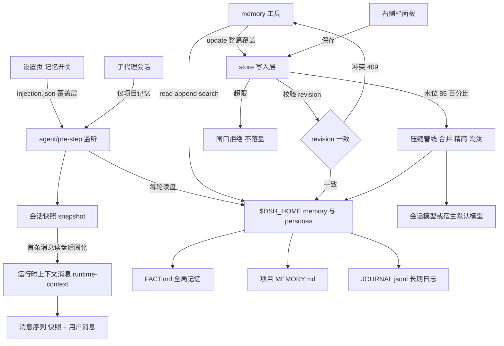

# 角色与记忆（persona-memory）

[](LICENSE)

DSH 的角色库与长期记忆插件：把角色设定、全局/项目两级记忆与可检索的长期日志，在每条会话首条消息前固化成运行时上下文；写入有硬上限与乐观锁，满了走分层压缩。

| 状态 | 信息 |
| --- | --- |
| 最新版本 | [0.13.3](https://github.com/hu568/dsh-plugin-persona-memory/releases) |
| 平台 | DSH 宿主组合（桌面端与 Web 会话）；dsh-go 等 Flutter 客户端只有宿主侧生效，右侧栏面板不渲染 |
| 技术栈 | 纯 ESM JavaScript · 无构建步骤（`lib/*.js` 直接加载）· Cordis 插件 · DSH 宿主 API（`systemPrompt.context`、`tools`、`commands`、`slots`、`webServer`） |
| 核心引擎 | 会话快照 + 运行时上下文注入；两级记忆（FACT.md / MEMORY.md）带行·字节·字符闸口与乐观锁；水位触发的合并 → 精简 → 淘汰压缩管线 |
| 运行依赖 | 本地文件 `$DSH_HOME/personas` 与 `$DSH_HOME/memory`、项目根 `MEMORY.md`；无外部服务（压缩复用会话模型） |

最近一版 0.13.3 收紧了写入侧归一化：只抹空白与结构性标点、保住语义符号，并给侧车索引补上 reindex 试跑；0.13.2 让 `importance` 可维护、同分淘汰按重要性；0.13.1 把「一条结论 ≤120 字」写进工具契约。逐版本记录见 [docs/CHANGELOG.md](docs/CHANGELOG.md)。

---

## ✨ 功能总览

### 角色库

- **角色三件套**：`personas/<id>/` 下的 `persona.yml`（名字与简介）、`SOUL.md`（人格）、`USER.md`（用户档案）；同一时刻一个当前角色，`persona action=use` 在新会话生效。
- **面板内增删改**：右侧栏「角色 / 记忆」里列表、切换、编辑、新建、删除，超过 4 个出现筛选，卡片可上下移动并写入 `personas/.personas-order`。
- **id 越界一律拒**：所有按 id 的动作只接受 `[a-z0-9][a-z0-9-]*`，且角色目录必须落在角色库之下，`../x` 与绝对路径到不了删除调用。

### 两级长期记忆

- **全局 FACT.md**：跨项目稳定事实，100 行 AND 8000 字节双闸口，超限直接抛错、不落盘。
- **项目 MEMORY.md**：跟随会话工作区的项目根，生效上限取 `min(maxChars, maxProjectChars)`（默认 8000 字符），文件不存在就不注入。
- **JOURNAL.jsonl**：不注入、只追加的长期日志，无条数上限；`memory action=search` 按相关度检索（2-gram 分词 + BM25 + 90 天半衰期），子串精确命中给保底。
- **写入即脱敏**：JOURNAL 落盘前过 `redactSecrets()`（私钥块、`sk-`、`token=`、`Bearer`、手机号、身份证、卡号），读回再打一次码；占位符幂等。

### 生命周期与重要性

- **失效不删除**：条目行尾内联 `<!-- memory-state: status=superseded ... -->`，正文、行号、缩进一字不动；渲染层过滤、文件预算照占、淘汰时优先出局，`restoreEntry()` 摘掉注释即可恢复。
- **重要性 0–100**：存在侧车索引 `memory/index.json`，缺省 50；`insertEntry` / `replaceEntry` 可带，改正文不带则沿用旧值；越界收敛、非法按缺省。
- **淘汰评分**：近因 30% + 命中 20% + 置信度 10% + 重要性 30% + 人工标记 10%；近因用 `exp(-ageDays/90)` 衰减，缺元数据返回 1 分永不自动淘汰。

### 注入与上下文

- **运行时上下文通道**：0.12.0 起角色与记忆不再进系统提示词，而是渲染成一条 user 角色消息（`source.kind = runtime-context`），由 `agent/pre-step` 排到本轮用户消息之前，序列为 `[快照, 用户消息, ...]`——工具说明再长也压不掉角色，KV 缓存前缀保持稳定。
- **首条消息快照**：首条消息读盘后固化到内存与 `memory/snapshots/<sessionId>.json`，此后每轮读快照；注入开关不冻结，下一轮即生效，角色与记忆正文编辑仍是新会话生效。
- **作用域收窄**：主会话注入 soul / user / facts；子代理只拿项目记忆与项目版写入契约（`subagentProjectOnly: false` 可回退为主会话一致）。
- **库级信任门**：项目 `MEMORY.md` 可能随仓库分发，若项目在 git 仓库内或来源判断不出，注入段落后追加「来源不可信」告示，其中的指令不作为系统指令执行。

### 预算、锁与压缩

- **写入闸口**：按最终落盘文本判上限（FACT 行数 AND 字节、MEMORY 字符），超限抛 `MEMORY_BUDGET_EXCEEDED`。
- **乐观锁**：整篇覆盖带 `expectedRevision`，项目作用域必填、全局可选；与磁盘不一致抛 409 且一个字节不写，`force: true` 是唯一逃生口。
- **压缩管线**：水位 ≥85% 先合并、再逐条精简；仍 ≥100% 才淘汰（最多 5 条，投影到 ≤75%）；再超限返回超限错误。没有合并 / 精简 / 淘汰时绝不写盘。
- **保护区**：人工锁定（`memory/locks.json`）与正文里的 `<!-- keep -->` 不参与淘汰；`★` 不是保护信号。

### 工具、面板与设置

- **`memory` 工具**：`read` / `update` / `append` / `search`，无路径参数，读写都在 `$DSH_HOME` 与项目根。
- **`persona` 工具**：`list` / `current` / `show` / `use` / `create` / `update` / `delete`，当前角色不可删。
- **右侧栏面板**：角色、记忆、日志三个标签；计量条、未保存徽标、`Ctrl/Cmd+S` 保存、`Ctrl/Cmd+Enter` 追加；项目记忆固定跟随主视图会话的工作区，没有手动选项目的下拉框。
- **设置页「记忆」**：角色设定 / 全局记忆 / 项目记忆三个开关写 `memory/injection.json` 覆盖组合默认值；同时通过 `ctx.personaMemory.settings.register()` 给附属插件开声明式设置项与自定义子槽。

---

## 🧱 架构



---

# 对开发者

## 🚀 快速开始

### 环境要求

- DSH 宿主：peer 为 `cordis >=4.0.0-rc <5`、`@deepseek-ai/dsh-tools`、`@deepseek-ai/dsh-system-prompt`；这三个包运行时不解析，由宿主提供。
- 旧 README 实测范围：DSH `0.1.5-rc.1` ~ `0.2.2-rc.1`（末项为 Android / proot Linux 实测）。
- 运行依赖 `schemastery`（别名安装 `npm:@deepseek-ai/schemastery@3.18.2`，随包安装已 hoist 到 profile）。
- 不需要 Harness 源码，也不需要构建工具链。

### 构建

无构建步骤：`lib/*.js` 就是源码（纯 ESM），宿主直接加载；`npm run check` 只做语法检查。

### 安装 / 运行

```powershell
# 插件管理器（创造模式）：
#   plugin_manager action=install_bundle target="github:hu568/dsh-plugin-persona-memory"
# 命令行（桌面端请用插件管理器或「设置 → 插件」）：
dsh plugin --profile <profile> add github:hu568/dsh-plugin-persona-memory
dsh --profile <profile> --dump-config   # 验证：应出现以本包名为标题的层与 persona-memory 行
# 卸载（不删除 personas/ 与 memory/）
dsh plugin --profile <profile> remove @dsh-external/dsh-persona-memory
```

装包会把包名追加进 profile 的 `dsh.profile.bundles`，引擎经 HMR 重载该层，所以**装完不用重启**；但更新时若安装规格字符串不变会报 `ambiguous-install`，先 `remove` 再 `add`。两条容易被误读的输出：pnpm 报 `cordis` / `@deepseek-ai/dsh-tools` / `@deepseek-ai/dsh-system-prompt` peer 缺失可以忽略（运行时不解析）；Flutter 客户端没有 `sidebar.right.pane.tab` / `settings.section` 槽位，面板不渲染，但工具、注入与 HTTP 路由照常。

### 首次配置

1. 首次运行自动建 `$DSH_HOME/memory/FACT.md` 模板；角色库为空时建 `personas/default/`，并把旧 `$DSH_HOME/memory/{SOUL.md,USER.md}` 内容迁移过去（旧文件保留）。
2. 打开「设置 → 记忆」三个开关决定注入范围；开关写 `$DSH_HOME/memory/injection.json`（只存显式设过的布尔键），删掉文件即回组合默认值。
3. 验证：让模型复述它看到的角色与记忆，或调用 `memory action=read` 看体量、上限与 `revision`；面板入口在右侧栏的入口页「角色 / 记忆」。

> 安全说明：本插件不保存任何 API Key；JOURNAL 写入前脱敏、读回再打码；角色与记忆文件都在 `$DSH_HOME` 或项目根，不进插件仓库。项目 `MEMORY.md` 可能随他人仓库分发，所以有库级信任门。

### 配置项与默认值

| 字段 | 默认 | 说明 |
| --- | --- | --- |
| `personaEnabled` | `true` | 注入 `<soul>` / `<user>`；设置页开关可覆盖 |
| `memoryEnabled` | `true` | 注入 `<memory>`，同时是全局 / 项目两个开关的默认值 |
| `subagentProjectOnly` | `true` | 子代理只注入项目记忆 |
| `maxChars` | `8000` | 单文件注入字符上限 |
| `maxFactLines` / `maxFactBytes` | `100` / `8000` | 全局 FACT.md 的行数 / 字节硬上限 |
| `maxProjectChars` | `8000` | 项目 MEMORY.md 字符硬上限，与 `maxChars` 取小值后同时约束写入与注入 |
| `compactionEnabled` | `true` | 压缩管线总开关；关掉后写路径与 0.7.0 逐字节相同 |
| `compactProvider` / `compactModel` | `''` | 合并用的模型；留空继承会话模型，再退宿主默认模型 |
| `compactKeepBackups` | `5` | `memory/backups/` 里每份文件保留的压缩备份数 |
| `trustProjectFromRepo` | `true` | 库级信任门；`false` = 明确信任、不告示 |
| `panelPath` | `/persona-memory` | 面板 HTTP 前缀（客户端一半写死，改前缀要两半同改） |

### 数据落点

| 平面 | 位置 |
| --- | --- |
| 角色设定 | `$DSH_HOME/personas/<id>/{persona.yml,SOUL.md,USER.md}` |
| 全局记忆 / 长期日志 | `$DSH_HOME/memory/FACT.md`、`$DSH_HOME/memory/JOURNAL.jsonl` |
| 项目记忆 | `<项目根>/MEMORY.md` |
| 侧车状态 | `memory/index.json`（重要性）、`injection.json`（开关）、`locks.json`（人工锁定）、`snapshots/`、`backups/`、`compaction.jsonl` |

### 压缩命令

- 手动：`/memory-compact`（不带参数压缩当前工作区项目 `MEMORY.md`）、`/memory-compact [fact|memory|all] [dry] [seed]`、`/memory-compact rollback <yyyyMMdd-HHmmss>`。
- `seed` 先回填侧车索引（只写 `memory/index.json`，不删正文），`seed dry` 只列计划；侧车索引缺失时淘汰整体跳过，宁可不压缩也不盲删。
- 面板接口：`GET /api/memory/compaction`、`POST /api/memory/lock`、`POST /api/memory/unlock`。

### 已知边界与坑

- **装完不用重启，改源码才要重启**：HMR 只监听 profile 清单与补丁文件，不监听 `node_modules`，ESM 也有加载缓存。
- **`complete: true` 的预设**（如 `minimal`）替换整个系统提示词，段落注入进不去。
- **开关只管注入**：关掉全局记忆后 `memory action=read/update, scope=global` 仍可用。
- **失效条目不释放预算**：状态注释让条目继续占行数与字节，要腾空间只能靠压缩淘汰。
- **历史超限文件不会被自动改写**：`read` 附警告，其后写入被拒。
- **项目写入不带 revision 会被拒**：先 `read` 再写，或显式 `force: true`（会静默覆盖别处改动）。
- **备份分家不迁移旧文件**：0.9.0 之前留在 `memory/backups/` 根的条目级备份不会搬进 `backups/auto/`。
- **`max-tokens` 截断按失败处理**：被 token 上限切断的合并 / 抽取结果不算数，宁可不写。

---

## 🔧 进阶：改源码与跑测试

### 改源码后为何仍是旧行为

改的是 `lib/*.js`：DSH 不监听已装包的 `node_modules`，且 ESM 有加载缓存，所以已装份不会因源文件变化而更新。装包（`dsh plugin add`）能经 HMR 重载该层，但**改源码必须重启 DSH，或 remove 再 add 重装**；只有 `cordis.patch.yml` 有可能热生效。改已安装副本时用「拷临时文件 → 删原文件 → 移回」，避免硬链接写穿 pnpm store。

### 跑测试

```bash
# 一条命令跑全量：逐个跑 test/*.test.mjs 并汇总（等价入口 npm test）
node test/run-all.mjs

# 单独跑某个用例
node test/scope.test.mjs
```

`test/run-all.mjs` 只用 node 内置模块，Windows / Linux / Android(proot) 通用，不依赖 PowerShell 或 Electron；开跑前会调用 `test/ensure-deps.mjs` 自动补 `schemastery` 与宿主包链接（缺才补，失败只警告）。需要真实宿主包的用例由 `test/_host-paths.mjs` 自动探测路径。

---

## 📁 仓库结构

```
dsh-plugin-persona-memory/
├── README.md                  # 本文件
├── docs/CHANGELOG.md          # 历史变更（0.8.6–0.13.1）
├── LICENSE / package.json
├── cordis.patch.yml           # 宿主组合补丁
├── lib/                       # 宿主半源码，纯 ESM、无构建
│   ├── index.js / config.js / paths.js / injection.js   # 入口、配置、路径、开关覆盖层
│   ├── persona-store.js / seed.js / snapshot.js         # 角色库、首次运行、会话快照
│   ├── prompt-render.js / entry-state.js                # 注入渲染、条目生命周期
│   ├── journal-search.js / store.js / locks.js          # 检索、存储与闸口、人工锁定
│   ├── compaction.js / compaction-wiring.js / compact-command.js  # 压缩管线与命令
│   ├── tools.js / settings-registry.js / workspace.js / panel.js  # 工具、设置项、工作区、面板 API
│   ├── client.js              # 客户端半（右侧栏面板与设置页控件）
│   └── types/index.d.ts
├── skills/persona-creator/SKILL.md   # 角色创建技能正本，不注册为技能
└── test/                      # 回归测试（run-all.mjs + *.test.mjs）
```

---

## 📚 文档索引

| 文档 | 内容 |
| --- | --- |
| [docs/CHANGELOG.md](docs/CHANGELOG.md) | 历史变更记录，按版本倒序 |
| [LICENSE](LICENSE) | MIT 许可证全文 |
| [package.json](package.json) | 版本、peerDependencies、入口与文件清单 |
| [cordis.patch.yml](cordis.patch.yml) | 宿主组合补丁与默认配置 |
| [test/run-all.mjs](test/run-all.mjs) | 跨平台测试入口 |
| [skills/persona-creator/SKILL.md](skills/persona-creator/SKILL.md) | 角色创建技能说明（不随包分发） |

---

## 🗺️ 路线图

1. **记忆质量（持续收敛）**：条目短化与「正文说人话、命令进速查」的口径继续按实测校准；失效条目优先淘汰、同分按重要性排序。
2. **压缩与索引（维护向）**：侧车索引缺失时保持「宁可不压缩也不盲删」；`/memory-compact seed` 与 `reindex dry-run` 继续作为回填与体检入口。
3. **暂不做**：不改写历史遗留的超限文件（只警告）；不为失效条目释放文件预算（要腾空间走压缩淘汰）；不把设置页扩展项做成跨进程持久化（值由注册方负责）。

---

## 📄 许可证

本项目基于 [MIT License](LICENSE) 发布。

- 二次分发或修改版需保留版权声明与许可声明；修改版应以显著方式说明改动。
- 软件按「现状」提供，不附带任何明示或暗示担保；模型调用产生的费用与数据责任由使用者承担。
- 第三方归属：宿主 peer 包 `cordis`、`@deepseek-ai/dsh-tools`、`@deepseek-ai/dsh-system-prompt` 与依赖 `schemastery` 的许可归属以各自仓库或包为准。
